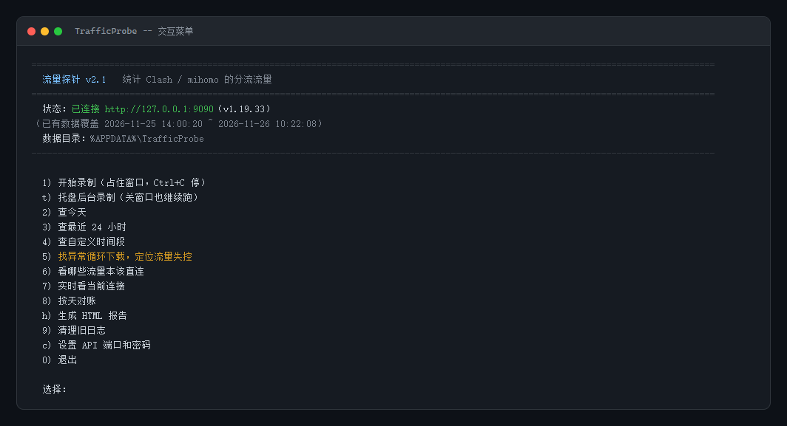
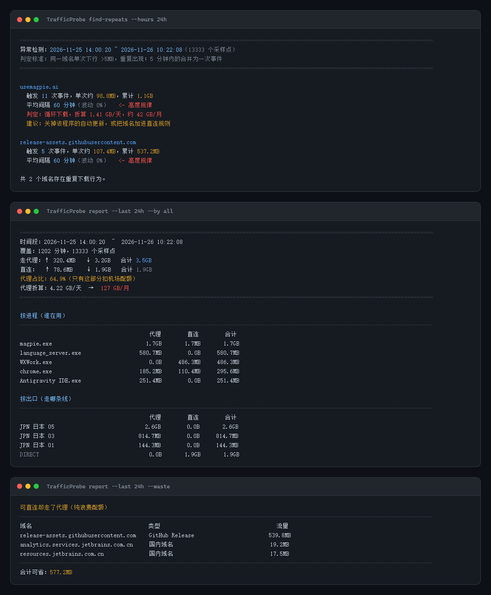

<div align="center">

# TrafficProbe 流量探针

统计 Clash / mihomo 的分流流量，查清每个程序、每个域名的用量，并找出被循环下载浪费掉的配额。

<br>

**仅离线分析，不上传任何数据到远程服务器。**

<sub>只读本机 Clash API，数据只写本机磁盘，无遥测、无账号、无第三方 SDK。</sub>

<br>

[](#安装)
[](#从源码运行)
[](#许可证)
[](#隐私说明)

</div>

---

## 目录

- [功能](#功能)
- [界面](#界面)
- [安装](#安装)
- [使用](#使用)
- [隐私说明](#隐私说明)
- [数据存放](#数据存放)
- [工作原理](#工作原理)
- [常见问题](#常见问题)
- [已知限制](#已知限制)
- [开发](#开发)
- [许可证](#许可证)

---

## 功能

| 能力 | 说明 |
|---|---|
| 五维统计 | 进程、域名、出口节点、小时、天，支持任意时间段 |
| 循环下载检测 | 按事件间隔的规律性识别重复下载 |
| HTML 报告 | 单文件，图表分代理与直连两色 |
| 系统托盘 | Windows 关闭控制台后继续运行 |
| 跨平台 | Windows、macOS、Linux |
| 进程归因 | 元数据缺进程名时按本地端口反查 PID |

---

## 界面

交互菜单（不带参数运行即进入）、命令行输出、HTML 报告。






报告图表中，蓝色为代理流量（计入机场配额），灰色为直连流量。

---

## 安装

从 [Releases](https://github.com/yutao8/TrafficProbe/releases) 下载，无需安装 Python。

### Windows

下载 `TrafficProbe.exe`，双击运行。

### macOS 与 Linux

下载对应压缩包，解压后授权运行：

```bash
tar -xzf TrafficProbe-macos.tar.gz
chmod +x TrafficProbe
./TrafficProbe
```

macOS 首次运行若被 Gatekeeper 拦截，在「系统设置 - 隐私与安全性」中允许。

### 从源码运行

只需 Python 3.8 以上，无第三方依赖：

```bash
git clone https://github.com/yutao8/TrafficProbe.git
cd TrafficProbe
python traffic_probe.py
```

---

## 使用

### 前置条件

Clash Verge 或 mihomo 需开启**外部控制器**。工具自动探测端口 9090、9097、9091、7890，可用 `c` 选项手动指定。

### 启动

```bash
# Windows
start.bat

# macOS / Linux
./start.sh

# 或直接运行，前台录制
TrafficProbe record
```

录制持续进行，数据按天写入。运行至少一天后可查询。

### 命令速查

```bash
# 录制
TrafficProbe record
TrafficProbe record --interval 1        # 1 秒采样，更精确
TrafficProbe record --tray              # 托盘或后台模式

# 查询
TrafficProbe report --last 24h
TrafficProbe report --from "2026-11-25 09:00" --to "2026-11-25 12:00"
TrafficProbe report --last 7d --by day
TrafficProbe report --last 7d --by host
TrafficProbe report --last 24h --waste   # 列出本该直连的流量
TrafficProbe report --last 7d --by all --csv out.csv

# 异常检测
TrafficProbe find-repeats --hours 24h
TrafficProbe find-repeats --hours 48h --threshold 10 --min-times 5

# HTML 报告
TrafficProbe html --last 24h
TrafficProbe html --last 7d -o my-report.html

# 实时监控
TrafficProbe live

# 维护
TrafficProbe prune --keep 30            # 只留最近 30 天
TrafficProbe span                       # 看录了哪些时间
```

<details>
<summary>完整参数说明</summary>

| 参数 | 适用命令 | 说明 |
|---|---|---|
| `--log` | 全部 | 日志路径，默认用户数据目录 |
| `--interval` | `record` | 采样间隔秒数，默认 5 |
| `--tray` | `record` | 托盘或后台模式 |
| `--from` `--to` | `report` `html` | 时间范围，格式 `2026-11-25 09:00` 或 `2026-11-25` |
| `--last` | `report` `html` `find-repeats` | 相对范围：`30m` `24h` `7d` |
| `--by` | `report` | 维度：`process` `host` `chain` `hour` `day` `all` |
| `--waste` | `report` | 附加输出本该直连清单 |
| `--csv` | `report` | 导出 CSV |
| `--top` | `report` `live` | 显示条数，默认 15 |
| `--hours` | `find-repeats` | 回看小时数，默认 24h |
| `--threshold` | `find-repeats` | 单次下行 MB 阈值，默认 5 |
| `--min-times` | `find-repeats` | 最少重复次数，默认 3 |
| `--keep` | `prune` | 保留天数，默认 30 |
| `--port` `--secret` | 全部 | 覆盖 API 端口或面板密码 |

</details>

---

## 隐私说明

全部功能在本机运行，无联网上报。

| 项 | 说明 |
|---|---|
| 数据来源 | 仅读取 `127.0.0.1` 上的 Clash / mihomo API |
| 数据去向 | 只写入本机用户目录（`%APPDATA%\TrafficProbe` 等） |
| 网络请求 | 除本地回环地址外，不发起任何连接 |
| 遥测 / 统计 | 无 |
| 账号 / 登录 | 不需要 |
| 生成报告 | 纯本地 HTML 文件，不依赖任何在线服务 |

代码集中在 `traffic_probe.py` 与 `report_html.py`，可逐行核对。

验证方式：运行期间执行 `netstat -ano | findstr <PID>`，仅见指向 `127.0.0.1:909x` 的连接。

---

## 数据存放

数据存放在**用户级应用目录**，与程序位置无关。

| 系统 | 路径 |
|---|---|
| Windows | `%APPDATA%\TrafficProbe` |
| macOS | `~/Library/Application Support/TrafficProbe` |
| Linux | `$XDG_DATA_HOME/TrafficProbe` 或 `~/.local/share/TrafficProbe` |

环境变量 `TRAFFIC_PROBE_HOME` 可覆盖此路径。

```
traffic.jsonl                 录制数据，约 20MB / 天
traffic_probe.conf.json       API 端口与密码
report_YYYYMMDD_HHMM.html     生成的报告
```

旧版数据位于程序旁的 `data/`，首次运行自动迁移，留下 `.migrated_from_portable` 标记。

---

## 工作原理

```
mihomo API  -- 每 5 秒轮询 /connections -->  每条连接的增量字节
                                              |
                     按 (进程, 域名, 出口节点) 聚合
                                              |
                            追加写入 traffic.jsonl
```

循环下载检测的逻辑：

1. 5 分钟内的多次采样合并为一次事件（更新包分多片下载）
2. 检查事件间隔是否规律：波动小于 30%，且间隔在 5 分钟至 24 小时之间
3. 只统计 2 小时间隔，排除休眠造成的空档

进程归因：元数据缺进程名时，用系统 TCP 表按本地端口反查 PID 后取进程名（Windows：`netstat -ano` + `tasklist`）。

---

## 常见问题

<details>
<summary>提示找不到 Clash 或 mihomo 的 API</summary>

1. 确认 Clash Verge 或 mihomo 正在运行
2. 确认设置里的外部控制器已开启
3. 确认端口在 9090、9097、9091、7890 之内，都不是就在菜单里按 `c` 手动填
</details>

<details>
<summary>托盘图标找不到</summary>

Windows 11 默认折叠新图标。在任务栏展开区将其拖到常显区。
</details>

<details>
<summary>中文显示乱码</summary>

程序启动时已切换 UTF-8 代码页。仍乱码时先执行 `chcp 65001`。
</details>

<details>
<summary>直连流量也算流量费吗</summary>

不算。仅经过代理节点的流量计入机场配额，`DIRECT` 只消耗本地带宽。
</details>

<details>
<summary>日志文件太大</summary>

约 20MB/天。用 `TrafficProbe prune --keep 30` 保留 30 天，或删除 `traffic.jsonl`。
</details>

<details>
<summary>macOS 或 Linux 没有托盘图标</summary>

标准库无跨平台托盘方案，`--tray` 降级为后台常驻进程，收到 SIGTERM 时退出。
</details>

---

## 已知限制

- **只能向前录，不能回溯**：mihomo API 只暴露当前活跃连接，启动前的流量查不到
- **采样间隙可能漏连接**：生命周期短于采样间隔（默认 5 秒）的连接抓不到，用 `--interval 1` 可缓解
- **进程反查依赖 netstat**：系统禁用 netstat，或连接存活时间短于 30 秒缓存时，仍可能显示问号
- **只统计经过 Clash 的流量**：TUN 模式约等于全部，系统代理模式只有走代理的部分

---

## 开发

```bash
# 语法检查
python -m py_compile traffic_probe.py report_html.py tray.py

# 跑一遍主要功能
python traffic_probe.py span
python traffic_probe.py report --last 1h
python traffic_probe.py html --last 1h --no-open
```

### 项目结构

```
TrafficProbe/
├── traffic_probe.py       主程序：录制、查询、异常检测、菜单
├── report_html.py         HTML 报告生成，纯字符串模板，无依赖
├── tray.py                跨平台托盘抽象
├── tray_win.py            Windows 托盘实现，ctypes 调 Shell_NotifyIcon
├── assets/                图标
├── docs/                  截图与示例报告
├── .github/workflows/     CI：三平台构建加 Release
├── start.bat  stop.bat    Windows 启停
└── start.sh   stop.sh     macOS 与 Linux 启停
```

### 自动构建

`.github/workflows/build.yml` 定义三个平台的构建：

| 触发条件 | 行为 |
|---|---|
| push 到 main 或 PR | 语法检查、三平台构建、冒烟测试、上传构建产物 |
| 打 v 开头的标签 | 额外创建 GitHub Release，附三个平台安装包 |
| 手动触发 | 同 PR，不发 Release |

### 本地打包

先安装 PyInstaller：

```bash
python -m PyInstaller --onefile --console --name TrafficProbe \
  --icon assets/trafficprobe.ico \
  --add-data "assets:assets" \
  --add-data "report_html.py:." \
  --add-data "tray.py:." \
  --add-data "tray_win.py:." \
  traffic_probe.py
```

Windows 下 `--add-data` 的分隔符是分号，macOS 和 Linux 是冒号。

### 不入库的内容

以下内容已在 `.gitignore` 中排除：

| 排除项 | 原因 |
|---|---|
| `TrafficProbe.exe`、`build/`、`dist/` | 构建产物，由 CI 生成 |
| `data/`、`*.jsonl`、`report_*.html` | 录制的真实流量数据，属于使用痕迹 |
| `traffic_probe.conf.json` | 本地 API 端口与面板密码 |
| `*.log`、`__pycache__/` | 临时文件 |

`docs/sample-report.html` 与 `docs/report-preview.png` 由 `docs/make_demo.py` 以固定随机种子生成，进程名、域名、IP 均为虚构。

---

## 许可证

[MIT](LICENSE)
