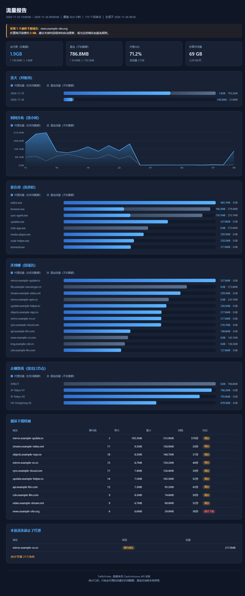

<div align="center">

# TrafficProbe 流量探针

统计 Clash / mihomo 的分流流量，查清每个程序、每个域名的用量，并找出被循环下载浪费掉的配额。

[](https://github.com/USERNAME/TrafficProbe/actions/workflows/build.yml)
[](https://github.com/USERNAME/TrafficProbe/releases)
[](#安装)
[](#从源码运行)
[](#许可证)

</div>

---

## 目录

- [这个工具解决什么问题](#这个工具解决什么问题)
- [功能](#功能)
- [界面](#界面)
- [安装](#安装)
- [使用](#使用)
- [数据存放](#数据存放)
- [工作原理](#工作原理)
- [常见问题](#常见问题)
- [已知限制](#已知限制)
- [开发](#开发)
- [许可证](#许可证)

---

## 这个工具解决什么问题

Clash / mihomo 面板只显示**当前**连接，关掉就没有历史。Windows 自带的数据使用量只到进程级，而且把直连和代理混在一起算。

结果是：月底流量超了，却不知道是哪个程序花的。

TrafficProbe 通过 mihomo 的 API 持续轮询，把增量流量按「进程 + 域名 + 出口节点」记录下来，写成本地日志。除了查询，它还能自动识别**循环下载**，也就是那种每小时重复拉一个 100MB 安装包、悄悄吃掉几十 GB 配额的浪费行为。

实测案例：某工具每 60 分钟重下一次 99MB 的更新包，一个月白烧 42 GB。工具靠间隔分析自动抓到了它。

---

## 功能

| 能力 | 说明 |
|---|---|
| 五维统计 | 按进程、域名、出口节点、小时、天查询任意时间段 |
| 循环下载检测 | 自动识别每隔固定时间重复下载同样大小的浪费行为 |
| HTML 报告 | 单文件网页，图表用两种颜色区分代理与直连 |
| 系统托盘 | Windows 关掉控制台也能继续录制 |
| 跨平台 | Windows、macOS、Linux，数据统一存用户目录 |
| 进程归因 | metadata 缺进程名时，用 TCP 表按端口反查 PID |

### 和其他方案的区别

| 能力 | Clash 面板 | Windows 数据使用量 | TrafficProbe |
|---|:---:|:---:|:---:|
| 历史记录 | 否 | 是 | 是 |
| 到进程 | 是 | 是 | 是 |
| 到域名 | 是 | 否 | 是 |
| 区分代理和直连 | 是 | 否 | 是 |
| 循环下载检测 | 否 | 否 | 是 |
| 可导出报告 | 否 | 否 | 是 |

---

## 界面



报告中的图表：蓝色为代理流量（扣机场配额），灰色为直连流量（不扣配额）。

命令行输出示例：

```console
$ TrafficProbe find-repeats --hours 24h
======================================================================
异常检测：2026-11-25 13:43:40 ~ 2026-11-26 08:14:43（13302 个采样点）
======================================================================

usemagpie.ai
  触发 11 次事件（原始 47 个采样），单次约 98.8MB，累计 1.1GB
  平均间隔 60 分钟（波动 0%，按 6 个有效间隔算）  <- 高度规律
  判定：循环下载，折算 1.41 GB/天，约 42 GB/月
  建议：关掉该程序的自动更新，或把域名加进直连规则
```

---

## 安装

### 直接下载

从 [Releases](https://github.com/USERNAME/TrafficProbe/releases) 下载对应平台的文件，无需安装 Python。

| 平台 | 文件 | 说明 |
|---|---|---|
| Windows x64 | `TrafficProbe.exe` | 双击运行 |
| macOS | `TrafficProbe-macos.tar.gz` | 解压后 `chmod +x TrafficProbe` |
| Linux | `TrafficProbe-linux.tar.gz` | 解压后 `chmod +x TrafficProbe` |

### 从源码运行

```bash
git clone https://github.com/USERNAME/TrafficProbe.git
cd TrafficProbe
python traffic_probe.py
```

只需 Python 3.8 以上，没有任何第三方依赖。

### 自行打包

```bash
pip install pyinstaller
python -m PyInstaller --onefile --console --name TrafficProbe \
  --icon assets/trafficprobe.ico \
  --add-data "assets:assets" \
  --add-data "report_html.py:." \
  --add-data "tray.py:." \
  --add-data "tray_win.py:." \
  traffic_probe.py
```

Windows 下 `--add-data` 的分隔符是分号，macOS 和 Linux 是冒号。

---

## 使用

### 前置条件

Clash Verge 或 mihomo 的**外部控制器**必须开启，位置在设置里的外部控制器一项。

工具会自动探测 9090、9097、9091、7890 四个端口，都不是就手动指定。

### 三步上手

第一步，启动录制。

```bash
# Windows：双击 start.bat，自动转入托盘后台
# macOS / Linux：
./start.sh
```

第二步，让它跑一段时间，建议至少一天。

第三步，查看结果。

```bash
TrafficProbe html --last 24h      # 生成报告并自动打开
TrafficProbe find-repeats         # 找异常循环下载
```

### 交互菜单

不带参数运行会进入菜单：

```console
======================================================================
  流量探针 v2.1   统计 Clash / mihomo 的分流流量
======================================================================
  状态：已连接 http://127.0.0.1:9097（v1.19.33）
（已有数据覆盖 2026-11-25 13:43:40 ~ 2026-11-26 09:04:35）
  数据目录：C:\Users\me\AppData\Roaming\TrafficProbe
----------------------------------------------------------------------
  1) 开始录制（占住窗口，Ctrl+C 停）
  t) 托盘后台录制（关窗口也继续跑）
  2) 查今天
  3) 查最近 24 小时
  4) 查自定义时间段
  5) 找异常循环下载，定位流量失控
  6) 看哪些流量本该直连
  7) 实时看当前连接
  8) 按天对账
  h) 生成 HTML 报告
  9) 清理旧日志
  c) 设置 API 端口和密码
  0) 退出
```

### 命令速查

```bash
# 录制
TrafficProbe record
TrafficProbe record --interval 1        # 1 秒采样，更精确
TrafficProbe record --tray              # 托盘或后台模式

# 查询
TrafficProbe report --last 24h
TrafficProbe report --from "2026-11-25 09:00" --to "2026-11-25 12:00"
TrafficProbe report --last 7d --by day
TrafficProbe report --last 7d --by host
TrafficProbe report --last 24h --waste   # 列出本该直连的流量
TrafficProbe report --last 7d --by all --csv out.csv

# 异常检测
TrafficProbe find-repeats --hours 24h
TrafficProbe find-repeats --hours 48h --threshold 10 --min-times 5

# HTML 报告
TrafficProbe html --last 24h
TrafficProbe html --last 7d -o my-report.html

# 实时监控
TrafficProbe live

# 维护
TrafficProbe prune --keep 30            # 只留最近 30 天
TrafficProbe span                       # 看录了哪些时间
```

<details>
<summary>完整参数说明</summary>

| 参数 | 适用命令 | 说明 |
|---|---|---|
| `--log` | 全部 | 日志路径，默认用户数据目录 |
| `--interval` | `record` | 采样间隔秒数，默认 5 |
| `--tray` | `record` | 托盘或后台模式 |
| `--from` `--to` | `report` `html` | 时间范围，格式 `2026-11-25 09:00` 或 `2026-11-25` |
| `--last` | `report` `html` `find-repeats` | 相对范围：`30m` `24h` `7d` |
| `--by` | `report` | 维度：`process` `host` `chain` `hour` `day` `all` |
| `--waste` | `report` | 附加输出本该直连清单 |
| `--csv` | `report` | 导出 CSV |
| `--top` | `report` `live` | 显示条数，默认 15 |
| `--hours` | `find-repeats` | 回看小时数，默认 24h |
| `--threshold` | `find-repeats` | 单次下行 MB 阈值，默认 5 |
| `--min-times` | `find-repeats` | 最少重复次数，默认 3 |
| `--keep` | `prune` | 保留天数，默认 30 |
| `--port` `--secret` | 全部 | 覆盖 API 端口或面板密码 |

</details>

---

## 数据存放

统一放在**用户级应用目录**，不受程序位置影响，重装不丢数据。

| 系统 | 路径 |
|---|---|
| Windows | `%APPDATA%\TrafficProbe` |
| macOS | `~/Library/Application Support/TrafficProbe` |
| Linux | `$XDG_DATA_HOME/TrafficProbe` 或 `~/.local/share/TrafficProbe` |

可用环境变量 `TRAFFIC_PROBE_HOME` 覆盖，用于便携模式或测试。

```
traffic.jsonl                 录制数据，约 20MB / 天
traffic_probe.conf.json       API 端口与密码
report_YYYYMMDD_HHMM.html     生成的报告
```

旧版本把数据放在程序旁的 `data/` 目录，首次运行会自动迁移，并留下 `.migrated_from_portable` 标记。

---

## 工作原理

```
mihomo API  -- 每 5 秒轮询 /connections -->  每条连接的增量字节
                                              |
                     按 (进程, 域名, 出口节点) 聚合
                                              |
                            追加写入 traffic.jsonl
```

循环下载检测的逻辑：

1. 把 5 分钟内的多次采样合并成一次事件，因为一个更新包会分多片下载
2. 检查事件间隔是否规律：波动小于 30%，且间隔在 5 分钟至 24 小时之间
3. 只统计 2 小时内的间隔，避免夜间休眠的长空档干扰判断

进程归因：mihomo 的 metadata 不总带进程名。此时用系统 TCP 表按本地端口反查 PID，再取进程名（Windows 用 `netstat -ano` 加 `tasklist`）。实测把未知进程占比从 950MB 降到 0%。

---

## 常见问题

<details>
<summary>提示找不到 Clash 或 mihomo 的 API</summary>

1. 确认 Clash Verge 或 mihomo 正在运行
2. 确认设置里的外部控制器已开启
3. 确认端口在 9090、9097、9091、7890 之内，都不是就在菜单里按 `c` 手动填
</details>

<details>
<summary>托盘图标找不到</summary>

Windows 11 默认折叠新图标。点任务栏的展开箭头，把流量探针图标拖到常显区即可。
</details>

<details>
<summary>中文显示乱码</summary>

程序启动时已自动切到 UTF-8 代码页。若仍乱码，先在终端执行 `chcp 65001`。
</details>

<details>
<summary>直连流量也算流量费吗</summary>

不算。只有经过代理节点的流量才扣机场配额，`DIRECT` 的流量只消耗本地宽带。报告里两者始终分开显示，避免误判。
</details>

<details>
<summary>日志文件太大</summary>

约 20MB 每天。用 `TrafficProbe prune --keep 30` 保留最近 30 天，或直接删 `traffic.jsonl`，不影响程序运行。
</details>

<details>
<summary>macOS 或 Linux 没有托盘图标</summary>

标准库没有跨平台托盘方案，`--tray` 会降级为后台常驻进程，收到 SIGTERM 时优雅退出。功能、数据、报告完全一致。
</details>

---

## 已知限制

- **只能向前录，不能回溯**：mihomo API 只暴露当前活跃连接，启动前的流量查不到
- **采样间隙可能漏连接**：生命周期短于采样间隔（默认 5 秒）的连接抓不到，用 `--interval 1` 可缓解
- **进程反查依赖 netstat**：系统禁用 netstat，或连接存活时间短于 30 秒缓存时，仍可能显示问号
- **只统计经过 Clash 的流量**：TUN 模式约等于全部，系统代理模式只有走代理的部分

---

## 开发

```bash
# 语法检查
python -m py_compile traffic_probe.py report_html.py tray.py

# 跑一遍主要功能
python traffic_probe.py span
python traffic_probe.py report --last 1h
python traffic_probe.py html --last 1h --no-open
```

### 项目结构

```
TrafficProbe/
├── traffic_probe.py       主程序：录制、查询、异常检测、菜单
├── report_html.py         HTML 报告生成，纯字符串模板，无依赖
├── tray.py                跨平台托盘抽象
├── tray_win.py            Windows 托盘实现，ctypes 调 Shell_NotifyIcon
├── assets/                图标
├── docs/                  截图与示例报告
├── .github/workflows/     CI：三平台构建加 Release
├── start.bat  stop.bat    Windows 启停
└── start.sh   stop.sh     macOS 与 Linux 启停
```

### 自动构建

`.github/workflows/build.yml` 定义三个平台的构建：

| 触发条件 | 行为 |
|---|---|
| push 到 main 或 PR | 语法检查、三平台构建、冒烟测试、上传 artifact |
| 打 v 开头的标签 | 额外创建 GitHub Release，附三个平台安装包 |
| 手动触发 | 同 PR，不发 Release |

---

## 许可证

[MIT](LICENSE)
